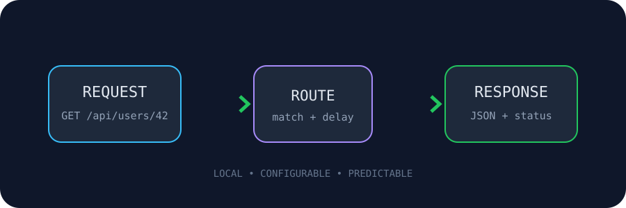

## 🧭 Overview
MockDock is a tiny local HTTP server driven by a JSON route file. Use it when a frontend or integration needs predictable API responses before the real backend is ready.

## ✨ Features
- 🧩 Match routes by HTTP method and path parameters such as <code>/users/:id</code>
- 📦 Return configurable JSON bodies and status codes
- ⏱️ Simulate network latency per route
- 🪵 Print a readable request log to the terminal
- 🔒 Bind to localhost by default; no account or external service required

## 🎬 Demo
Request <code>http://127.0.0.1:3000/api/users/42</code> while the server is running:
~~~json
{"id":"42","name":"Sample User"}
~~~

## 🚀 Quick Start
Requires Node.js 18 or newer.
~~~bash
npm start
~~~
In another terminal:
~~~bash
curl http://127.0.0.1:3000/api/health
curl http://127.0.0.1:3000/api/users/42
npm test
~~~
Edit <code>mocks.json</code> to add routes. Set <code>PORT</code> or <code>MOCKS_FILE</code> to customize the server.

## 🧰 Tech Stack
- 🟢 Node.js built-in HTTP server
- 📄 JSON route configuration
- 🧪 Node.js built-in test runner

## 🗂️ Folder Structure
~~~text
mockdock/
├── assets/overview.svg
├── tests/server.test.js
├── mocks.json
├── server.js
├── package.json
├── .gitignore
└── README.md
~~~

## 🗺️ Roadmap
- [ ] 🧾 Optional request-body match rules
- [ ] 🧪 Response templates with reusable fixtures
- [ ] 📤 Export captured requests as test fixtures

## 🤝 Contributing
Issues and pull requests are welcome. Keep changes small, add tests for route behavior, and document configuration options.

## 📄 License
MIT — see [LICENSE](LICENSE).

